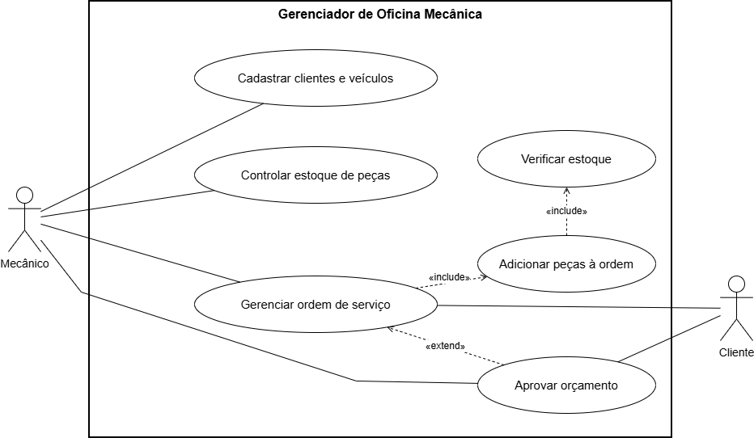
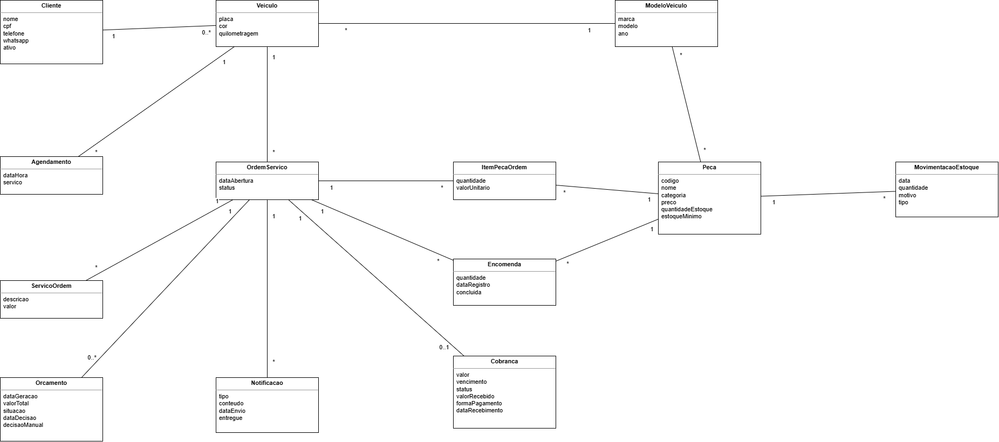
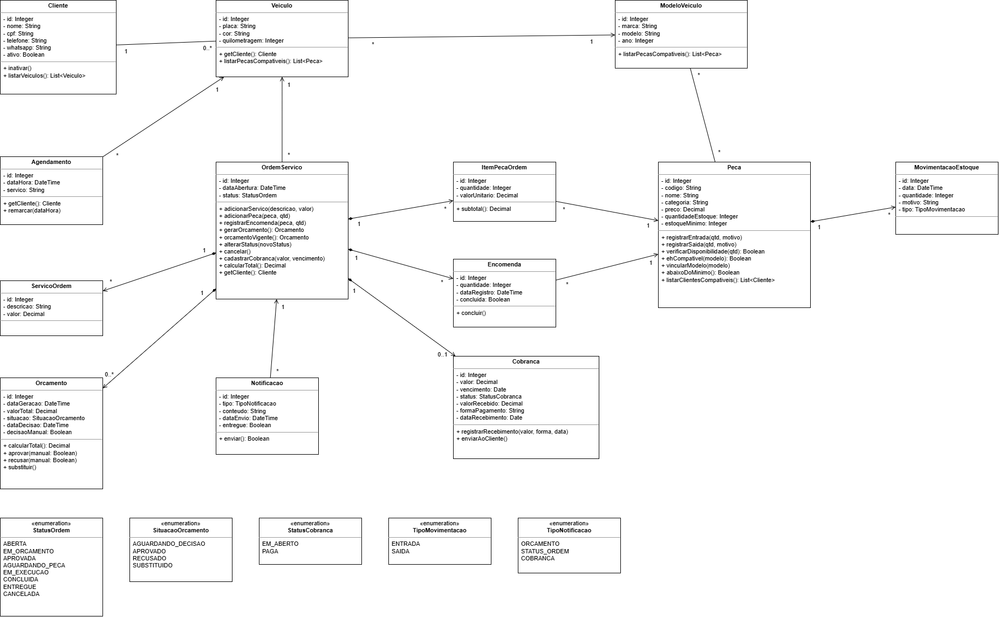

# Documentação

## Requisitos

### Índice

- [Requisitos funcionais](./requisitos-regras/requisitos-funcionais.md)
- [Requisitos não funcionais](./requisitos-regras/requisitos-nao-funcionais.md)
- [Regras de negócio](./requisitos-regras/regras-negocio.md)

### Documentos

- [Documento_Requisitos_Oficina.docx](./docs/Documento_Requisitos_Oficina.docx)

## Casos de uso

### Índice

- [UC01 – Cadastrar clientes e veículos](./casos-de-uso/UC01-cadastrar-clientes-e-veiculos.md)
- [UC02 – Controlar estoque de peças](./casos-de-uso/UC02-controlar-estoque-de-pecas.md)
- [UC03 – Gerenciar ordem de serviço](./casos-de-uso/UC03-gerenciar-ordem-de-servico.md)
- [UC04 – Verificar estoque](./casos-de-uso/UC04-verificar-estoque.md)
- [UC05 – Aprovar orçamento](./casos-de-uso/UC05-aprovar-orcamento.md)

### Documentos

- [UC01_Cadastrar_clientes_e_veiculos.docx](./docs/UC01_Cadastrar_clientes_e_veiculos.docx)
- [UC02_Controlar_estoque_de_pecas.docx](./docs/UC02_Controlar_estoque_de_pecas.docx)
- [UC03_Gerenciar_ordem_de_servico.docx](./docs/UC03_Gerenciar_ordem_de_servico.docx)
- [UC04_Verificar_estoque.docx](./docs/UC04_Verificar_estoque.docx)
- [UC05_Aprovar_orcamento.docx](./docs/UC05_Aprovar_orcamento.docx)

## Diagramas de classe

### Modelo conceitual

[Arquivo editável](./diagrams/diagrama_classes_conceitual.drawio)

### Modelo de domínio

[Arquivo editável](./diagrams/diagrama_classes_dominio.drawio)
