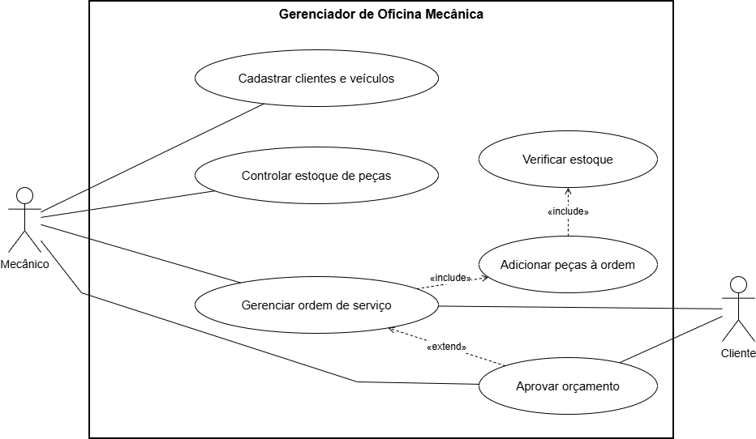
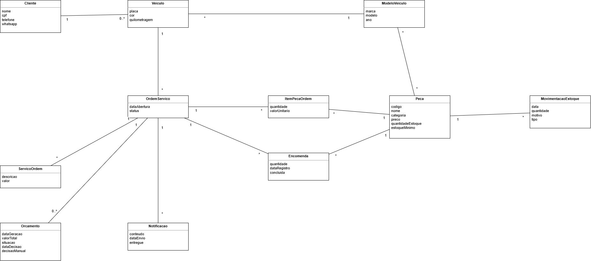
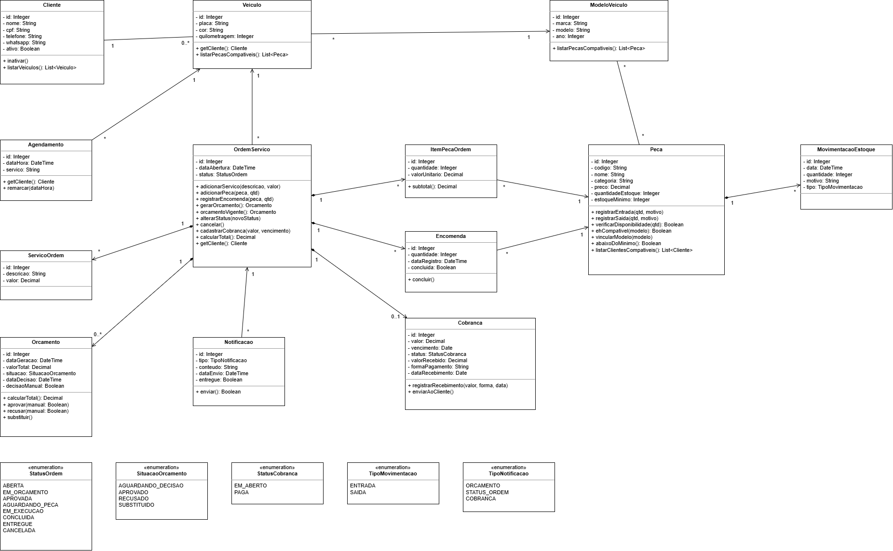
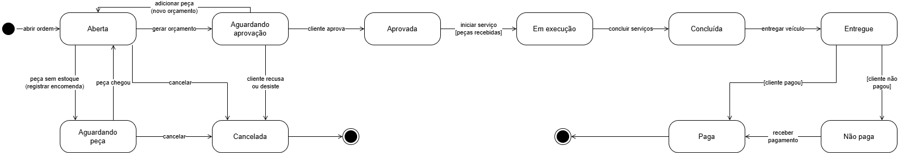

# Documentação

## Índice

- [Requisitos](#requisitos)
  - [Requisitos funcionais](./requisitos-funcionais.md)
  - [Requisitos não funcionais](./requisitos-nao-funcionais.md)
  - [Regras de negócio](./regras-negocio.md)
- [Casos de uso](#casos-de-uso)
  - [UC01 – Cadastrar clientes e veículos](./casos-de-uso/UC01-cadastrar-clientes-e-veiculos.md)
  - [UC02 – Controlar estoque de peças](./casos-de-uso/UC02-controlar-estoque-de-pecas.md)
  - [UC03 – Gerenciar ordem de serviço](./casos-de-uso/UC03-gerenciar-ordem-de-servico.md)
  - [UC04 – Verificar estoque](./casos-de-uso/UC04-verificar-estoque.md)
  - [UC05 – Aprovar orçamento](./casos-de-uso/UC05-aprovar-orcamento.md)
  - [UC06 – Adicionar peças à ordem](./casos-de-uso/UC06-adicionar-pecas-a-ordem.md)
- [Modelagem](#modelagem)
  - [Diagrama de classes – modelo conceitual](#diagrama-de-classes--modelo-conceitual)
  - [Diagrama de classes – modelo de domínio](#diagrama-de-classes--modelo-de-domínio)
  - [Diagrama de máquina de estados – ordem de serviço](#diagrama-de-máquina-de-estados--ordem-de-serviço)

## Requisitos

### Índice

- [Requisitos funcionais](./requisitos-funcionais.md)
- [Requisitos não funcionais](./requisitos-nao-funcionais.md)
- [Regras de negócio](./regras-negocio.md)

### Documentos

- [Documento_Requisitos_Oficina.docx](./docs/Documento_Requisitos_Oficina.docx)

## Casos de uso

### Índice

- [UC01 – Cadastrar clientes e veículos](./casos-de-uso/UC01-cadastrar-clientes-e-veiculos.md)
- [UC02 – Controlar estoque de peças](./casos-de-uso/UC02-controlar-estoque-de-pecas.md)
- [UC03 – Gerenciar ordem de serviço](./casos-de-uso/UC03-gerenciar-ordem-de-servico.md)
- [UC04 – Verificar estoque](./casos-de-uso/UC04-verificar-estoque.md)
- [UC05 – Aprovar orçamento](./casos-de-uso/UC05-aprovar-orcamento.md)
- [UC06 – Adicionar peças à ordem](./casos-de-uso/UC06-adicionar-pecas-a-ordem.md)

### Documentos

- [UC01_Cadastrar_clientes_e_veiculos.docx](./docs/UC01_Cadastrar_clientes_e_veiculos.docx)
- [UC02_Controlar_estoque_de_pecas.docx](./docs/UC02_Controlar_estoque_de_pecas.docx)
- [UC03_Gerenciar_ordem_de_servico.docx](./docs/UC03_Gerenciar_ordem_de_servico.docx)
- [UC04_Verificar_estoque.docx](./docs/UC04_Verificar_estoque.docx)
- [UC05_Aprovar_orcamento.docx](./docs/UC05_Aprovar_orcamento.docx)
- [UC06_Adicionar_pecas_a_ordem.docx](./docs/UC06_Adicionar_pecas_a_ordem.docx)

## Modelagem

### Diagrama de classes – modelo conceitual

### Diagrama de classes – modelo de domínio

### Diagrama de máquina de estados – ordem de serviço

### Arquivos editáveis

- [diagrama_casos_de_uso.drawio](./diagramas/diagrama_casos_de_uso.drawio)
- [diagrama_classes_conceitual.drawio](./diagramas/diagrama_classes_conceitual.drawio)
- [diagrama_classes_dominio.drawio](./diagramas/diagrama_classes_dominio.drawio)
- [diagrama_maquina_estados.drawio](./diagramas/diagrama_maquina_estados.drawio)